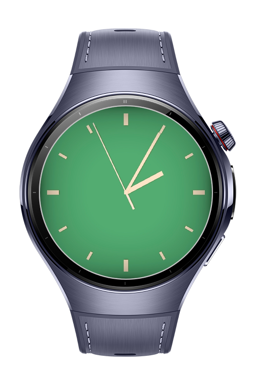
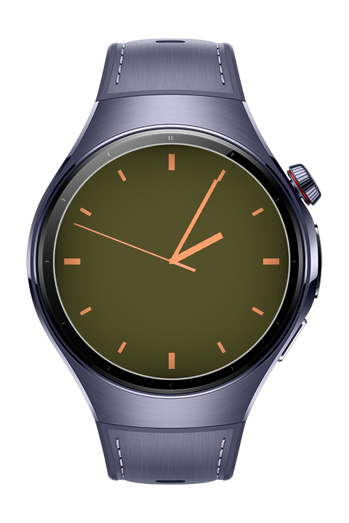
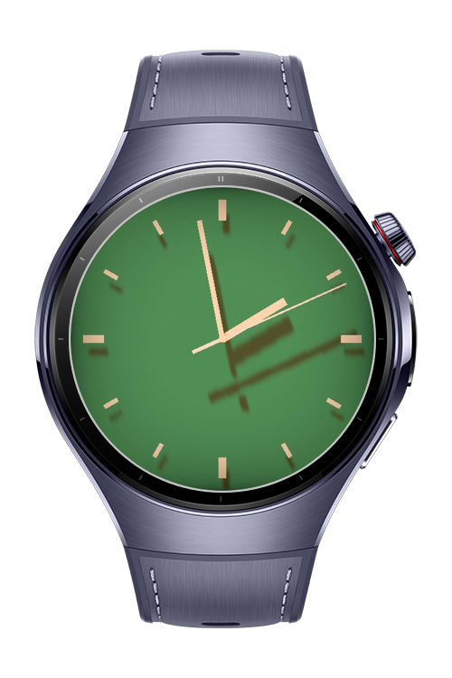

> **Note:** To access all shared projects, get information about environment setup, and view other guides, please visit [Explore-In-HMOS Index](https://github.com/Explore-In-HMOS/hmos-index).

# How to build 3D watch face development

How to build 3D watch face development is a real-time 3D watch face engine built on the scene graph and renders a metallic dial with 3D hour, minute, and second hands. It also includes physically inspired lighting where a fixed overhead "sun" reacts to wrist tilt, so the hands cast shadows that move across the dial as the watch is turned.

# Preview
<div>
  
  
  
  
</div>

# Use Cases
- A real-time 3D scene rendered through a scene graph (Scene + Node hierarchy)
- Procedural geometry for the dial, hands, indices, and centre cap (vertex colors)
- Hour, minute, and second hands animated from the system clock
- Wrist-tilt driven lighting (gravity sensor maps to a fixed overhead sun)
- Real-time shadows cast by the hands onto the dial
- On-demand, battery-aware rendering loop

# Tech Stack
**Languages**: ArkTS, ArkUI
**Libraries/Kits**:
- @kit.ArkGraphics3D
- @kit.SensorServiceKit
- @kit.ArkUI

# Directory Structure
```
entry/src/main/
└───main
    │   module.json5
    ├───ets
    │   ├───pages
    │   │       Index.ets
    │   │
    │   └───watchface
    │           Lighting.ets
    │           Materials.ets
    │           MathUtil.ets
    │           SceneGraph.ets
    │           TiltSensor.ets
    │           WatchFaceEngine.ets
    │
    └───resources
        └───base
            └───profile
                    main_pages.json
```

# Constraints and Restrictions
## Supported Devices
- Huawei Watch 5
- DevEco Studio Simulator

# LICENSE
**How to build a 3D watch face** is distributed under the terms of the **MIT License**.
See the [LICENSE](/LICENSE) for more information.